# 📖 Panduan Integrasi Fitur Materi Kuliah, Arsitektur Teknologi, dan Setup Aplikasi FoodFlow

> **Dokumen Resmi Integrasi Kurikulum & Panduan Instalasi Sistem**  
> **Aplikasi:** FoodFlow — Sistem ERP Manajemen Operasional Dapur & Evaluasi Gizi MBG  
> **Lokasi Implementasi:** SPPG Dapur MBG Malang 01, Kota Malang, Jawa Timur  
> **Framework & Bahasa:** Laravel 12 / PHP 8.4  
> **Database:** PostgreSQL (Supabase Cloud Hosted) / SQLite (Automated Testing)  
> **Frontend:** Blade Templates, Tailwind CSS v3.4, Alpine.js  

---

## 📋 Daftar Isi
1. [Ringkasan Eksekutif & Filosofi Sistem](#-1-ringkasan-eksekutif--filosofi-sistem)
2. [Evaluasi Kesesuaian Kurikulum & Materi Perkuliahan (Bab 1 s.d. 9)](#-2-evaluasi-kesesuaian-kurikulum--materi-perkuliahan-bab-1-sd-9)
3. [Bank Pertanyaan & Jawaban Dosen Penguji (Defense Guide)](#-3-bank-pertanyaan--jawaban-dosen-penguji-defense-guide)
4. [Katalog Teknologi: Pake Apa Aja, Di Mana Letaknya, & Fungsinya Apa](#-4-katalog-teknologi-pake-apa-aja-di-mana-letaknya--fungsinya-apa)
5. [Rincian Arsitektur Modul Bisnis ERP](#-5-rincian-arsitektur-modul-bisnis-erp)
6. [Panduan Instalasi & Setup Step-by-Step dari Nol](#-6-panduan-instalasi--setup-step-by-step-dari-nol)
7. [Panduan Skenario Demo & Sidang Presentasi](#-7-panduan-skenario-demo--sidang-presentasi)
8. [Kronologi Lengkap Perjalanan Pengembangan Sistem (End-to-End Development Journey)](#-8-kronologi-lengkap-perjalanan-pengembangan-sistem-end-to-end-development-journey)

---

## 🎯 1. Ringkasan Eksekutif & Filosofi Sistem

Aplikasi **FoodFlow** dikembangkan untuk mendigitalkan seluruh mata rantai operasional pada **Sentra Pengolahan Pangan Bergizi (SPPG)** program Makan Bergizi Gratis (MBG) di Kota Malang. Sistem ini menggantikan pencatatan manual di buku, papan tulis, atau spreadsheet yang rentan selisih, lambat, dan tidak memiliki audit trail.

### Prinsip Arsitektur Utama:
1. **Monolith Model-View-Controller (MVC):**  
   Seluruh logika bisnis, otorisasi, interaksi basis data, dan antarmuka pengguna berada dalam satu kesatuan runtime Laravel. Pendekatan ini dipilih karena memberikan integritas transaksi database (ACID) murni, kecepatan respons tanpa latensi antar-layanan, serta kemudahan proses audit keamanan.
2. **Multi-Page Application (MPA) Berbasis Server-Side Rendering (SSR):**  
   Setiap navigasi halaman merender HTML aman langsung dari server, meminimalisir footprint memori pada perangkat staf operasional di dapur yang umumnya berspesifikasi standar.
3. **Reaktivitas Mikro Sisi Klien (Alpine.js):**  
   Interaktivitas dinamis (seperti penambahan baris resep masakan, kalkulasi harga seketika, dan modal konfirmasi) ditangani langsung oleh Alpine.js tanpa overhead build framework Single Page Application (SPA) yang rumit.

---

## 🗺️ 2. Evaluasi Kesesuaian Kurikulum & Materi Perkuliahan (Bab 1 s.d. 9)

Berikut adalah matriks kesesuaian antara 9 bab materi perkuliahan dengan implementasi riil pada codebase FoodFlow:

| Bab | Topik Materi Perkuliahan | Status di FoodFlow | Implementasi Konkret pada Sistem |
| :---: | :--- | :---: | :--- |
| **Bab 1** | **Arsitektur Web Modern** (Monolith vs Microservices, MPA vs SPA) | ✅ **100% Sesuai** | Menerapkan Monolith MVC murni berbasis MPA. Sangat ideal untuk sistem back-office operasional internal perusahaan. |
| **Bab 2** | **HTTP, Routing, MVC, & Controller** | ✅ **100% Sesuai** | Seluruh rute memiliki *named route*, grouped route berbasis middleware role, pemisahan controller terstruktur, dan type-hinting ketat pada setiap parameter dan return type. |
| **Bab 3** | **Frontend: Blade, Tailwind CSS, Alpine.js** | ✅ **100% Sesuai** | Layout inheritance (`layouts/app.blade.php`), 10+ komponen Blade reusable (`x-modal`, `x-dropdown`), utilitas styling Tailwind responsif, dan reaktivitas interaktif form repeater via Alpine.js. |
| **Bab 4** | **Desain Basis Data, Migrasi, & Supabase** | ✅ **100% Sesuai** | Skema 17 tabel relasional ternormalisasi (3NF), migrasi terstruktur dengan foreign key cascade/restrict, tipe data moneter dan takaran desimal presisi (`numeric(12,2)` dan `numeric(12,3)`), terkoneksi ke PostgreSQL Supabase Cloud dengan SSL. |
| **Bab 5** | **Eloquent ORM, Relasi, Pagination, Eager/Lazy Loading** | ✅ **100% Sesuai** | Menerapkan relasi `hasMany`, `belongsTo`, `belongsToMany` (pivot table), dan `hasManyThrough`. Mencegah N+1 query problem via eager loading `with()`, menerapkan 17+ local query scope, dan pagination konsisten di seluruh tabel. |
| **Bab 6** | **Validasi Data & Form Request** | ✅ **100% Sesuai** | Diterapkan pada **19 Form Request Class** khusus. Menggunakan nested array validation (`items.*.ingredient_id`), validasi dinamis berdasarkan unit tipe, dan pesan kesalahan ramah berbahasa Indonesia. |
| **Bab 7** | **Autentikasi, Otorisasi, RBAC, & Security** | ✅ **95% Sesuai** | Scaffolding Laravel Breeze, Single Sign-On (SSO) Google OAuth 2.0 via Laravel Socialite, RBAC 4 Peran, pembatasan rate limiting 5x/menit anti-brute force, Bcrypt hashing, dan proteksi CSRF. |
| **Bab 8** | **Transaksi DB, Idempotency, Reporting & Batch** | ✅ **85% Sesuai** | Penerapan `DB::transaction()` dan pesimistic locking `lockForUpdate()` untuk mencegah race condition mutasi stok barang. Cetak laporan eksekutif resmi A4 portrait. Batch seeding masif. |
| **Bab 9** | **REST API, Sanctum, & API Resources** | ⚠️ **Sengaja Dikecualikan** | *Architectural Decision:* FoodFlow dirancang khusus sebagai sistem web internal operasional (bukan multi-client mobile). Penambahan REST API sengaja dihindari untuk menjaga arsitektur tetap bersih dan aman (*lihat bab 3 untuk argumentasi ilmiahnya*). |

**Tingkat Pemenuhan Kurikulum:** **~76% Materi Kurikulum Terpenuhi Penuh** dengan kualitas kode tingkat industri (*production-grade*).

---

## 🛡️ 3. Bank Pertanyaan & Jawaban Dosen Penguji (Defense Guide)

Bagian ini disiapkan khusus sebagai panduan argumentasi teknis saat menghadapi evaluasi dosen pembimbing atau dewan penguji sidang:

### Q1: Mengapa aplikasi ini tidak menggunakan REST API dan framework SPA (React/Vue/Next.js)?
> **Jawaban Akademis & Teknis:**  
> "Aplikasi FoodFlow adalah sistem ERP operasional internal (*back-office enterprise*) yang digunakan oleh staf dapur, gudang, dan pimpinan di lokasi dapur.  
> 1. **Integritas Transaksi:** Dengan arsitektur Monolith SSR (Server-Side Rendering), validasi form, otorisasi sesi, dan transaksi database multi-tabel (`DB::transaction`) tereksekusi secara atomik dalam satu runtime tanpa risiko kegagalan jaringan parsial antar-layanan (*network split*).  
> 2. **Performa Perangkat:** Staf gudang dan dapur sering mengakses sistem melalui tablet atau PC kasir dengan spesifikasi standar. SPA yang mengunduh bundle JavaScript besar akan memperlambat waktu muat awal (*First Contentful Paint*). Kombinasi Blade + Tailwind + Alpine.js memberikan performa instan dengan konsumsi memori browser yang sangat ringan.  
> 3. **Keamanan:** Autentikasi berbasis HTTP-only session cookie Laravel Breeze secara inheren kebal terhadap pencurian token via serangan *Cross-Site Scripting (XSS)* yang sering menjadi celah pada token JWT/Bearer di SPA."

### Q2: Mengapa otorisasi multi-role menggunakan Middleware dan Enum, bukan Laravel Gate/Policy?
> **Jawaban Akademis & Teknis:**  
> "Pada arsitektur FoodFlow, pemisahan tanggung jawab (*separation of concerns*) didasarkan pada **Course-Grained Role-Based Access Control (RBAC)**:
> 1. Hak akses diisolasi secara tegas di gerbang kernel rute menggunakan Middleware `EnsureUserHasRole` yang memvalidasi PHP 8.4 Backed Enum `UserRole`. Hal ini memastikan staf gudang tidak akan pernah bisa mengakses seluruh gugus controller produksi sama sekali.  
> 2. Pada level form input, setiap `FormRequest` class mengimplementasikan method `authorize()` yang memvalidasi hak aksi secara spesifik (misal hanya Admin yang boleh mengeksekusi `StoreUserRequest`).  
> 3. Pendekatan ini lebih ringkas, minim boilerplate, dan mudah diaudit (*highly audit-friendly*) untuk sistem enterprise dengan segregasi divisi yang kaku."

### Q3: Mengapa cetak laporan eksekutif menggunakan styling print browser (`@page A4 portrait`) dan bukan package DomPDF atau Snappy?
> **Jawaban Akademis & Teknis:**  
> "Pemilihan CSS Print Engine modern (`@page { size: A4 portrait; margin: 15mm; }`) didasarkan pada pertimbangan:  
> 1. **100% Desain Presisi:** Library PHP PDF (seperti DomPDF) memiliki keterbatasan dalam merender flexbox, grid modern, dan subpixel rendering CSS3. Dengan memanfaatkan browser print engine, tampilan dokumen cetak 100% identik dengan standar visual Tailwind CSS.  
> 2. **Efisiensi Server:** Pembuatan PDF di sisi server untuk laporan bertabel ratusan baris menyedot memori RAM CPU server secara signifikan (*resource intensive*). Dengan *client-side browser printing*, beban rendering dialihkan ke komputer klien (*zero server memory footprint*).  
> 3. **Pagination Cerdas:** Sistem dilengkapi CSS `thead { display: table-header-group; }` dan `page-break-inside: avoid;` sehingga judul kolom tabel otomatis berulang di setiap halaman baru dan baris tanda tangan tidak akan terpotong."

---

## 🧰 4. Katalog Teknologi: Pake Apa Aja, Di Mana Letaknya, & Fungsinya Apa

Berikut adalah tabel rincian menyeluruh tentang seluruh teknologi, pustaka, dan fitur yang digunakan pada sistem FoodFlow:

| Teknologi / Pustaka | Lokasi File di Codebase | Fungsi Teknis | Manfaat Bisnis di Dapur MBG |
| :--- | :--- | :--- | :--- |
| **Laravel Breeze (Blade Stack)** | `routes/auth.php`<br>`app/Http/Controllers/Auth/`<br>`resources/views/auth/` | Fondasi autentikasi session-based, proteksi CSRF, proteksi logout POST, dan layout Blade guest. | Mengamankan akses sistem dari pihak luar. Login aman bagi 4 divisi pegawai. |
| **Laravel Socialite (Google SSO)** | `app/Http/Controllers/Auth/SocialiteController.php`<br>`config/services.php`<br>`routes/auth.php` | Integrasi protokol OAuth 2.0 Google. Otentikasi identitas pihak ketiga yang terverifikasi. | Memudahkan staf login dengan sekali klik menggunakan akun email Google resmi tanpa perlu menghafal kata sandi rumit. |
| **Multi-Role RBAC Middleware** | `app/Enums/UserRole.php`<br>`app/Http/Middleware/EnsureUserHasRole.php`<br>`bootstrap/app.php` | Pengecekan peran pengguna secara ketat di pipeline HTTP request. Memblokir akses liar dengan HTTP 403. | Mencegah staf dapur mengedit saldo kas/PO gudang, dan staf gudang mengubah racikan gizi menu masakan. |
| **Rate Limiting & Throttling** | `app/Http/Requests/Auth/LoginRequest.php`<br>`app/Providers/AppServiceProvider.php` | Pembatasan frekuensi request ke endpoint login (maksimal 5x percobaan gagal per menit). | Melindungi sistem dari serangan brute force dan *credential stuffing* hacker. |
| **Bcrypt Password Hashing** | `app/Models/User.php` (`casts: hashed`)<br>`app/Http/Requests/Admin/StoreUserRequest.php` | Enkripsi satu arah (*one-way hash*) kata sandi menggunakan algoritma Blowfish adaptif. | Menjamin privasi data: kata sandi tidak pernah disimpan dalam format teks polos (*plain text*). |
| **Admin-Approval Password Reset** | `app/Http/Controllers/Admin/PasswordResetRequestController.php`<br>`resources/views/admin/password-resets/` | Alur permintaan ganti sandi internal yang memerlukan persetujuan fisik/verifikasi Admin. | Mencegah pengambilalihan akun staf dapur tanpa verifikasi langsung oleh supervisor operasional. |
| **1-Click Demo Role Switcher** | `app/Http/Controllers/DemoRoleSwitcherController.php`<br>`resources/views/components/demo-role-switcher.blade.php`<br>`routes/web.php` | Endpoint pengalih sesi otentikasi seketika antar-role dengan satu klik tombol. | Memudahkan presenter dan penguji berpindah sudut pandang akun (Admin $\leftrightarrow$ Gudang $\leftrightarrow$ Produksi $\leftrightarrow$ Owner) dalam hitungan detik saat sidang demo. |
| **Alpine.js Dynamic Repeater** | `resources/views/catering-orders/create.blade.php`<br>`resources/views/purchase-orders/create.blade.php` | Manipulasi state data array di sisi browser untuk menambah/menghapus baris item masakan secara instan. | Staf kasir bisa menambahkan puluhan menu pesanan sekolah secara fleksibel dalam satu formulir input. |
| **Realtime Calculation Engine** | `resources/views/catering-orders/create.blade.php`<br>`resources/js/app.js` | Formula matematika di memori browser yang mengalikan kuantitas dengan harga satuan/porsi seketika. | Menghitung subtotal dan estimasi total biaya pesanan secara otomatis tanpa perlu merefresh halaman. |
| **Domain Service Layer** | `app/Services/ProductionIngredientCalculator.php`<br>`app/Services/MaterialReceiptService.php`<br>`app/Services/UnitConverter.php` | Pemisahan logika bisnis murni ke dalam kelas terisolasi (*Single Responsibility Principle*). | Menghitung kebutuhan gramasi bahan mentah (beras, sayur, daging) otomatis berdasarkan jumlah porsi menu sekolah. |
| **Database Transaction & Lock** | `app/Http/Controllers/Gudang/StockCardController.php`<br>`app/Services/MaterialReceiptService.php` | Menggunakan `DB::transaction()` dan `lockForUpdate()` pada row bahan baku. | Menjamin keakuratan saldo stok barang, mencegah selisih data akibat input bersamaan (*race condition*). |
| **Database Seeder Komprehensif** | `database/seeders/DatabaseSeeder.php`<br>`database/seeders/IngredientSeeder.php`<br>`database/seeders/ProductSeeder.php`<br>`database/seeders/ProductionPlanSeeder.php` | Pengisian puluhan master data bahan, produk gizi, dan transaksi secara otomatis via Faker. | Menyediakan data siap uji untuk memvalidasi fungsi Pagination (10 data per halaman) dan filter pencarian. |
| **Executive Print CSS** | `resources/views/owner/reports/inventory-print.blade.php`<br>`resources/views/owner/reports/production-print.blade.php` | Aturan cetak `@media print` dan `@page { size: A4 portrait; }` dengan header tabel berulang otomatis. | Menghasilkan berkas cetak fisik atau PDF resmi yang rapi untuk arsip akuntabilitas ke Badan Gizi Nasional (BGN). |
| **PHPUnit Automated Testing** | `tests/Feature/`<br>`tests/Unit/`<br>`phpunit.xml` | Pengujian fungsional otomatis terhadap alur autentikasi, otorisasi peran, validasi input, dan reporting. | Menjamin kualitas perangkat lunak bebas regresi (*bug-free*) sesuai kaidah Penjaminan Mutu Perangkat Lunak (PMPL). |
| **Laravel Pint Formatter** | `vendor/bin/pint`<br>`pint.json` | Pengoreksi gaya penulisan kode PHP otomatis sesuai standar industri PSR-12. | Menjaga konsistensi sintaks kode di seluruh tim pengembang. |

---

## 🏗️ 5. Rincian Arsitektur Modul Bisnis ERP

Codebase FoodFlow dibagi ke dalam 4 domain operasional utama:

```mermaid
graph TD
    A[FoodFlow ERP] --> B[Domain Admin / Operasional]
    A --> C[Domain Gudang / Persediaan]
    A --> D[Domain Produksi / Gizi]
    A --> E[Domain Owner / Monitoring]

    B --> B1[User Management & RBAC]
    B --> B2[Master Data Supplier & Pelanggan]
    B --> B3[Pesanan Katering / Sekolah]
    B --> B4[Approval Permohonan Reset Password]

    C --> C1[Master Bahan Baku & Stok Minimum]
    C --> C2[Purchase Order Pengadaan Bahan]
    C --> C3[Penerimaan Bahan dari Vendor]
    C --> C4[Kartu Mutasi Stok & Penyesuaian Fisik]

    D --> D1[Master Menu Hidangan MBG & Resep]
    D --> D2[Perencanaan Produksi Harian]
    D --> D3[Kalkulator Kebutuhan Bahan Otomatis]
    D --> D4[Permintaan Pengambilan Bahan ke Gudang]
    D --> D5[Pencatatan Realisasi Masak & Suhu Makanan]

    E --> E1[Executive Dashboard Live KPI]
    E --> E2[Monitoring Live Realisasi Produksi]
    E --> E3[Evaluasi & Pengawasan Gizi Harian]
    E --> E4[Pusat Cetak Laporan PDF Resmi A4]
```



### Letak File Berdasarkan Modul:
1. **Manajemen Pengguna & Keamanan:**  
   - Controller: `app/Http/Controllers/Admin/UserController.php`, `PasswordResetRequestController.php`
   - Form Requests: `app/Http/Requests/Admin/StoreUserRequest.php`, `UpdateUserRequest.php`
   - Views: `resources/views/admin/users/`, `resources/views/admin/password-resets/`
2. **Master Data & Inventaris Gudang:**  
   - Controller: `app/Http/Controllers/IngredientController.php`, `SupplierController.php`, `CustomerController.php`
   - Services: `app/Services/MaterialReceiptService.php`, `UnitConverter.php`
   - Views: `resources/views/ingredients/`, `resources/views/suppliers/`, `resources/views/customers/`
3. **Pengadaan (Procurement / PO):**  
   - Controller: `app/Http/Controllers/PurchaseOrderController.php`, `MaterialReceiptController.php`
   - Views: `resources/views/purchase-orders/`, `resources/views/material-receipts/`
4. **Dapur Masak & Resep Gizi:**  
   - Controller: `app/Http/Controllers/ProductController.php`, `ProductionPlanController.php`, `ProductionController.php`
   - Service: `app/Services/ProductionIngredientCalculator.php`
   - Views: `resources/views/products/`, `resources/views/production-plans/`, `resources/views/productions/`
5. **Eksekutif & Pelaporan:**  
   - Controller: `app/Http/Controllers/Owner/DashboardController.php`, `ReportController.php`, `NutritionMonitoringController.php`
   - Views: `resources/views/owner/dashboard.blade.php`, `resources/views/owner/reports/`

---

## 🚀 6. Panduan Instalasi & Setup Step-by-Step dari Nol

Panduan ini dapat digunakan oleh dosen, asisten laboratorium, atau rekan satu tim untuk menjalankan aplikasi FoodFlow pada komputer lokal:

### A. Prasyarat Lingkungan
Pastikan komputer telah terpasang:
- **PHP:** Versi 8.4 (aktifkan ekstensi `pdo_pgsql`, `openssl`, `mbstring`, `curl`, `fileinfo`).
- **Composer:** Versi 2.8 atau lebih baru.
- **Node.js:** Versi 20 LTS atau lebih baru, beserta NPM.
- **Git:** Versi terbaru.

---

### B. Langkah 1: Klon Repositori & Persiapan File `.env`
Buka terminal PowerShell / Bash dan jalankan:
```bash
# Masuk ke direktori web server (misal Laragon / XAMPP)
cd c:\laragon\www

# Salin file environment contoh
cd Foodflow
cp .env.example .env
```

Buka file `.env` dan atur kredensial aplikasi:
```env
APP_NAME=FoodFlow
APP_ENV=local
APP_KEY=
APP_DEBUG=true
APP_TIMEZONE=Asia/Jakarta
APP_URL=http://localhost:8000
```

Buat kunci enkripsi aplikasi:
```bash
php artisan key:generate
```

---

### C. Langkah 2: Konfigurasi Basis Data PostgreSQL (Supabase Cloud)
FoodFlow menggunakan PostgreSQL Supabase Cloud untuk memastikan integritas data. Sesuaikan blok database pada file `.env`:

```env
DB_CONNECTION=pgsql
DB_HOST=aws-0-ap-south-1.pooler.supabase.com
DB_PORT=5432
DB_DATABASE=postgres
DB_USERNAME=postgres.YOUR_PROJECT_ID
DB_PASSWORD=YOUR_SUPABASE_PASSWORD
DB_SSLMODE=require
```

> [!TIP]
> **Jika ingin menjalankan secara lokal (offline):** Anda dapat mengganti ke PostgreSQL lokal (`DB_HOST=127.0.0.1`, `DB_PORT=5432`, `DB_SSLMODE=prefer`), atau menggunakan SQLite sementara untuk kebutuhan pengujian unit test.

---

### D. Langkah 3: Setup Laravel Breeze (Authentication Foundation)
Laravel Breeze sudah terpasang dan dikustomisasi di dalam repositori.

**Jika ingin memahami langkah instalasi awalnya:**
```bash
# Mengunduh paket scaffolding Breeze
composer require laravel/breeze --dev

# Memasang scaffolding Blade
php artisan breeze:install blade --no-interaction
```

**Kustomisasi Khusus FoodFlow pada Breeze:**
1. **Penutupan Registrasi Publik:**  
   File `routes/auth.php` telah disesuaikan agar rute `/register` publik dialihkan kembali ke `/login`. Akun pegawai hanya dapat dibuat secara resmi oleh Admin melalui menu Manajemen Pengguna.
2. **Redirection Berbasis Role:**  
   Pada `app/Http/Controllers/Auth/AuthenticatedSessionController.php`, setelah otentikasi berhasil, sistem mengarahkan pengguna ke dashboard spesifik perannya:
   ```php
   return redirect()->intended($user->getDashboardRoute());
   ```
   - Admin $\rightarrow$ `/admin/dashboard`
   - Gudang $\rightarrow$ `/gudang/dashboard`
   - Produksi $\rightarrow$ `/produksi/dashboard`
   - Owner $\rightarrow$ `/owner/dashboard`

---

### E. Langkah 4: Setup Laravel Socialite (Google OAuth SSO)
Fitur Google SSO memungkinkan pegawai login langsung menggunakan akun email Google yang sudah didaftarkan sebelumnya oleh Admin.

1. **Paket yang Digunakan:**
   ```bash
   composer require laravel/socialite
   ```
2. **Pengaturan di Google Cloud Console:**
   - Kunjungi [Google Cloud Console](https://console.cloud.google.com/).
   - Buat Project baru: `FoodFlow SPPG`.
   - Buka menu **APIs & Services** $\rightarrow$ **Credentials** $\rightarrow$ **Create Credentials** $\rightarrow$ **OAuth Client ID**.
   - Pilih Application Type: **Web application**.
   - Masukkan **Authorized redirect URIs**:
     - Lokal: `http://localhost:8000/auth/google/callback` (atau domain Laragon: `http://foodflow.test/auth/google/callback`)
3. **Pengaturan pada `.env`:**
   ```env
   GOOGLE_CLIENT_ID=masukkan_client_id_dari_google_console
   GOOGLE_CLIENT_SECRET=masukkan_client_secret_dari_google_console
   GOOGLE_REDIRECT_URI="${APP_URL}/auth/google/callback"
   ```
4. **Pengaturan pada `config/services.php`:**
   ```php
   'google' => [
       'client_id' => env('GOOGLE_CLIENT_ID'),
       'client_secret' => env('GOOGLE_CLIENT_SECRET'),
       'redirect' => env('GOOGLE_REDIRECT_URI'),
   ],
   ```

---

### F. Langkah 5: Migrasi Database & Seeding Data Pengujian
Jalankan perintah migrasi dan pengisian data uji:

```bash
# Menjalankan seluruh migrasi skema tabel
php artisan migrate

# Mengisi seluruh master data, akun demo, dan data transaksi
php artisan db:seed
```

**Hasil Seeding Otomatis:**
- **4 Akun Demo Multi-Role Siap Pakai:**
  | Role / Divisi | Alamat Email | Kata Sandi | Dashboard Default |
  | :--- | :--- | :--- | :--- |
  | **Admin** | `admin@foodflow.test` | `password` | `/admin/dashboard` |
  | **Staff Gudang** | `gudang@foodflow.test` | `password` | `/gudang/dashboard` |
  | **Staff Produksi** | `produksi@foodflow.test` | `password` | `/produksi/dashboard` |
  | **Owner / Pimpinan** | `owner@foodflow.test` | `password` | `/owner/dashboard` |
- **28 Bahan Baku Lengkap** (mengaktifkan pagination 3 halaman di master bahan baku).
- **22 Resep Menu MBG Bergizi** (mengaktifkan pagination di katalog hidangan & evaluasi gizi).
- **16 Jadwal Rencana Produksi Masak** (mengaktifkan pagination & live tracking).
- **Puluhan Riwayat Kartu Stok Barang** (membuat cetak laporan multi-halaman siap uji).

---

### G. Langkah 6: Kompilasi Aset Frontend (Tailwind CSS & Vite)
Install dependensi JavaScript dan lakukan build aset produksi:

```bash
# Mengunduh dependensi frontend
npm install

# Melakukan kompilasi Tailwind CSS dan Vite
npm run build
```

*(Untuk keperluan live development, Anda dapat menjalankan `npm run dev` di terminal terpisah).*

---

### H. Langkah 7: Menjalankan Pengujian Otomatis & Formatter
Untuk memvalidasi keandalan sistem:

```bash
# Menjalankan seluruh pengujian PHPUnit
php artisan test --compact

# Menjalankan formatter standar kode (Pint)
vendor/bin/pint --format agent
```

---

## 🎭 7. Panduan Skenario Demo & Sidang Presentasi

Untuk mempermudah demonstrasi di hadapan dosen penguji tanpa membuang waktu bolak-balik login/logout, manfaatkan fitur **1-Click Demo Role Switcher**:

### A. Fitur Demo Role Switcher
1. Login menggunakan akun apa saja (contoh: `admin@foodflow.test`).
2. Perhatikan dua widget navigasi demo yang tersedia di layar:
   - **Header Bar Navigasi:** Di samping foto profil pengguna pada bagian kanan atas.
   - **Floating Action Bar:** Melayang di pojok kanan bawah layar.
3. Cukup klik tombol peran (**Admin**, **Gudang**, **Produksi**, atau **Owner**) $\rightarrow$ Sesi akun akan langsung berganti dalam waktu kurang dari 1 detik dan otomatis membuka dashboard divisi terkait.

### B. Alur Cerita Skenario Demo End-to-End:
1. **Sebagai Admin:**
   - Buka menu **Pesanan Katering** (`/catering-orders`).
   - Tunjukkan pembuatan pesanan katering sekolah SD di Malang (gunakan Alpine.js repeater untuk menambah baris pesanan menu secara dinamis).
2. **Beralih ke Produksi (1-Click Switcher):**
   - Buka menu **Rencana Produksi** (`/production-plans`).
   - Tunjukkan kalkulator kebutuhan bahan otomatis (`ProductionIngredientCalculator`): dari target 1.250 porsi, sistem otomatis menghitung kebutuhan kg beras, daging, dan sayur.
   - Ajukan permintaan bahan baku digital ke gudang.
3. **Beralih ke Gudang (1-Click Switcher):**
   - Buka menu **Permintaan Bahan Masuk** & **Kartu Stok** (`/ingredients`).
   - Tunjukkan stok berkurang secara otomatis dan tercatat dalam kartu mutasi stok secara atomik (`lockForUpdate`).
4. **Beralih ke Owner (1-Click Switcher):**
   - Buka **Dashboard Live Monitoring KPI** (`/owner/dashboard`).
   - Tunjukkan metrik porsi harian, kepatuhan gizi, dan alert bahan kritis.
   - Buka menu **Pusat Cetak Laporan Eksekutif** (`/owner/reports`).
   - Klik tombol **Cetak Laporan Inventaris / Produksi** $\rightarrow$ Dialog print browser akan membuka dokumen dalam tata letak rapi **A4 Portrait**, header tabel berulang, dan widget demo switcher otomatis tersembunyi berkat class `print:hidden`.

---

## 📜 8. Kronologi Lengkap Perjalanan Pengembangan Sistem (End-to-End Development Journey)

Bagian ini mendokumentasikan seluruh tahapan rekayasa perangkat lunak FoodFlow secara kronologis: dari tahap konsepsi awal, perancangan arsitektur, implementasi modul 4 divisi, penjaminan mutu otomatis, peluncuran halaman publik, inovasi tanda tangan digital kanvas, hingga deployment cloud production di AWS EC2.

```
┌────────────────────────────────────────────────────────────────────────────────────────┐
│                      PETA KRONOLOGIS PENGEMBANGAN SISTEM FOODFLOW                      │
├────────────────────────────────────────────────────────────────────────────────────────┤
│ 1. Inisiasi & Desain Sistem      │ PRD, UseCaseSPEC, Batasan Ruang Lingkup, Postgres   │
│ 2. Fondasi Keamanan & Auth       │ Breeze, 4 Peran RBAC, Admin Approval, Google SSO    │
│ 3. Master Data & Siklus Order    │ Pelanggan, Bahan Baku, Menu Gizi, Resep, Order Form │
│ 4. Perencanaan Dapur & Gizi      │ Min Stok, Jadwal Masak, Ingredient Calculator       │
│ 5. Pengadaan & Mutasi Stok IN    │ PO Supplier, Penerimaan Bahan, Cek Fisik, Stok IN   │
│ 6. Operasional Masak & Stok OUT  │ Verifikasi Bahan Dapur, Catat Porsi, Bahan Riil     │
│ 7. Eksekutif & Laporan Cetak     │ Live Dashboard KPI, Evaluasi Gizi, Cetak A4 Portrait│
│ 8. Quality Assurance & Testing   │ 289+ PHPUnit Tests, Pint, 1-Click Role Switcher Demo│
│ 9. Public Landing Page           │ Rebranding ERP Katering Sentral, Animasi, Auth Link │
│ 10. Digital Signature (Canvas)   │ HTML5 Canvas Signature Pad, Ttd Otomatis, Print CSS │
│ 11. Cloud AWS EC2 Deployment     │ Ubuntu 24.04, Nginx, Let's Encrypt SSL, DuckDNS     │
└────────────────────────────────────────────────────────────────────────────────────────┘
```

### 🗓️ Rincian Perjalanan Lengkap Per Fase:

#### 🔹 Fase 1: Inisiasi Proyek, Analisis Kebutuhan, & Arsitektur Inti
- **Latar Belakang:** Proyek dirancang untuk mengatasi inefisiensi pencatatan manual di Sentra Pengolahan Pangan Bergizi (SPPG) Dapur MBG Kalideres 01 yang kemudian disesuaikan dengan kebutuhan SPPG Dapur MBG Malang 01 serta industri katering sentral.
- **Analisis Kebutuhan:** Membedah dokumen `docs/PRD.md` dan `docs/UseCaseSPEC.md` untuk memetakan aktor dan use case fungsional.
- **Penetapan Batasan Ketat (*In-Scope vs Out-of-Scope*):**
  - Pemeriksaan bahan baku tiba dibatasi pada status fisik praktis (`Baik`, `Rusak`, `Kedaluwarsa`, `Tidak Sesuai`), bukan uji laboratorium sains.
  - Saldo stok bahan baku tidak boleh diedit manual secara bebas, melainkan wajib dihitung murni dari agregasi transaksi mutasi stok: $\text{Stok Akhir} = \text{Total IN} - \text{Total OUT} \pm \text{ADJUSTMENT}$.
- **Pemilihan Stack Teknologi:** Memilih arsitektur Monolith Server-Side Rendering (Laravel 12 + PHP 8.4) dengan Tailwind CSS, Alpine.js, dan basis data PostgreSQL Supabase Cloud demi menjamin integritas transaksi (ACID) dan performa tinggi pada perangkat kasir/dapur berspesifikasi standar.

#### 🔹 Fase 2: Fondasi Autentikasi Multi-Role, Keamanan, & Akun Staf
- **Scaffolding:** Mengintegrasikan Laravel Breeze stack Blade dengan session-cookie HTTP-only.
- **Course-Grained RBAC:** Mendefinisikan 4 peran utama melalui Backed Enum `UserRole` (`admin`, `gudang`, `produksi`, `owner`) dan mengamankan rute melalui middleware `EnsureUserHasRole`.
- **Manajemen Akun:** Membangun modul Kelola Pengguna (`UserManagement`), alur reset sandi internal yang memerlukan otorisasi fisik admin (`PasswordResetRequest`), dan modal konfirmasi logout interaktif.
- **Otentikasi Modern:** Menambahkan fitur Single Sign-On (SSO) Google OAuth 2.0 via Laravel Socialite (`feat/socialite-auth` / PR #40) sehingga staf dapat login sekali klik menggunakan akun Google institusi.

#### 🔹 Fase 3: Master Data & Manajemen Siklus Pesanan Pelanggan (Admin)
- **Master Data Inti:** Membangun CRUD Master Bahan Baku (`ingredients`), Master Supplier/Pemasok (`vendors`), dan Master Pelanggan Katering (`customers`).
- **Master Menu & Komposisi Resep:** Membangun modul Menu Makanan (`products`) lengkap dengan validasi ambang batas Angka Kecukupan Gizi (AKG) serta pembangun resep dinamis (`Recipe Builder`) yang memetakan takaran bahan per porsi.
- **Siklus Transaksi Pesanan:** Membangun formulir pembuatan pesanan katering (`catering_orders`) yang mendukung multi-item dinamis menggunakan Alpine.js repeater, kalkulasi total biaya seketika di browser, pemfilteran status pesanan (Pending $\rightarrow$ Confirmed $\rightarrow$ Processing $\rightarrow$ Completed $\rightarrow$ Cancelled), serta cetak invoice.

#### 🔹 Fase 4: Perencanaan Dapur, Penjadwalan Masak, & Agregasi Bahan (Produksi & Gizi)
- **Kontrol Ambang Batas Stok:** Menambahkan field `minimum_stock` dan indikator alert peringatan stok menipis pada gudang (`feat/ingredients-min-stock`).
- **Jadwal Rencana Produksi:** Membangun modul penjadwalan masak harian (`production_plans`) yang mengelompokkan pesanan sekolah dan target porsi makan siang.
- **Domain Service Mesin Hitung Bahan:** Mengembangkan kelas layanan `ProductionIngredientCalculator` untuk menghitung kebutuhan total gramasi bahan mentah secara otomatis dari target ribuan porsi yang direncanakan.
- **Permintaan Bahan Dapur:** Membangun formulir pengajuan kebutuhan bahan mentah dari dapur ke gudang (`material_requests`).

#### 🔹 Fase 5: Rantai Pasok Pengadaan PO, Penerimaan Fisik, & Mutasi Stok Masuk (Gudang)
- **Pengadaan Bahan:** Membangun modul Purchase Order ke supplier (`purchase_orders`) untuk mencegah kekosongan stok bahan sebelum jadwal masak dimulai.
- **Penerimaan Fisik & Pemeriksaan Barang:** Membangun form penerimaan barang tiba (`material_receipts`), di mana staf gudang memeriksa kesesuaian fisik dan memilih status kelayakan barang.
- **Otomatisasi Stok Masuk (IN):** Sesuai aturan bisnis BR-04, hanya bahan yang berstatus `Baik` yang otomatis menambah stok gudang melalui mutasi transaksi `IN`.
- **Kartu Mutasi Stok & Stock Opname:** Membangun riwayat kartu stok (`stock_cards`) dan modul penyesuaian fisik (`ADJUSTMENT`) dengan proteksi `DB::transaction()` dan pesimistic lock (`lockForUpdate`) untuk menghindari race condition.

#### 🔹 Fase 6: Operasional Masak Riil, Mutasi Keluar OUT, & Pencatatan Porsi Matang (Dapur)
- **Pengeluaran Bahan Dapur:** Verifikasi pengeluaran bahan baku oleh petugas gudang yang otomatis membukukan transaksi mutasi Stok Keluar (`OUT`).
- **Pencatatan Realisasi Produksi:** Staf dapur mencatat hasil masak riil porsi makanan yang matang dan siap distribusikan (`production_realizations`), serta menandai rencana produksi selesai.
- **Pemakaian Bahan Aktual:** Mencatat penggunaan bahan baku riil di lapangan vs takaran estimasi resep untuk mendeteksi deviasi/efisiensi masak dapur.

#### 🔹 Fase 7: Dashboard Live Monitoring Owner, Evaluasi Gizi, & Laporan Cetak A4 Portrait
- **Dashboard Eksekutif Owner:** Menyajikan ringkasan metrik performa operasional: capaian porsi masakan harian, status bahan kritis gudang, dan tingkat pemenuhan pesanan pelanggan.
- **Evaluasi Kepatuhan Gizi:** Visualisasi persentase kecukupan gizi makanan sehat (kalori, protein, lemak, karbohidrat) terhadap standar katering/MBG.
- **Pusat Cetak Laporan Eksekutif:** Membangun halaman cetak laporan resmi untuk Laporan Jadwal Produksi dan Laporan Mutasi Persediaan Gudang.
- **Standarisasi Cetak A4 Portrait Modern:** Menyelesaikan kendala pemotongan tabel pada printer dengan mengimplementasikan CSS `@page { size: A4 portrait; margin: 12mm 15mm; }`, pengulangan header tabel otomatis (`thead { display: table-header-group; }`), pencegahan pemotongan tanda tangan (`page-break-inside: avoid;`), dan penyembunyian kontrol navigasi (`.no-print`).

#### 🔹 Fase 8: Quality Assurance, Automated Testing, & Tooling Sidang
- **Pengujian Otomatis Komprehensif:** Mengembangkan test suite PHPUnit dengan 289+ skenario uji otomatis (*feature tests & unit tests*) mencakup otorisasi RBAC, integritas transaksi stok, kalkulasi gizi, dan boundary validation.
- **Standarisasi Gaya Kode:** Memastikan seluruh kode PHP mematuhi PSR-12 menggunakan Laravel Pint (`vendor/bin/pint --format agent`).
- **1-Click Demo Role Switcher:** Menciptakan bilah navigasi demo instan (di header dan floating button) yang memungkinkan presenter sidang berganti identitas pengguna (Admin $\leftrightarrow$ Gudang $\leftrightarrow$ Produksi $\leftrightarrow$ Owner) dalam waktu kurang dari 1 detik tanpa perlu logout/login manual.
- **Massive Database Seeder:** Menyusun seeder realistis dengan 200 data siswa, 22 resep menu bergizi, 16 jadwal produksi, dan puluhan riwayat mutasi stok.

#### 🔹 Fase 9: Pembuatan & Redesign Public Landing Page
- **Halaman Muka Publik:** Merancang halaman landing page modern (`welcome.blade.php`) agar publik dan calon mitra katering dapat melihat profil layanan, keunggulan gizi, dan transparansi dapur.
- **Reorganisasi Routing:** Memastikan rute `/` mengarah langsung ke landing page publik tanpa dipaksa redirect ke halaman login, serta menambahkan tombol navigasi *"Kembali ke Beranda"* pada halaman login.
- **Rebranding Fokus ERP Katering Sentral:** Menyesuaikan narasi dari sebelumnya yang terlalu kaku di program MBG menjadi **Sistem ERP Manajemen Bisnis Katering & Dapur Sentral Terintegrasi**.
- **Pembersihan Elemen & Harmonisasi Visual:** Menghapus floating badge stok melayang, menyelaraskan palet warna brand ke tema Royal Violet (`#7C5CE0`) & deep ink (`#0F0E26`/`#18153A`), mendesain ulang footer, serta menambahkan efek animasi interaktif (glow orbs, card hover, progress bar).
- **Branch Fitur:** Dipisahkan secara rapi ke branch `feat/landing-erp-revamp`.

#### 🔹 Fase 10: Inovasi Tanda Tangan Digital Interaktif pada Dokumen Laporan
- **Kebutuhan Bisnis:** Laporan eksekutif persediaan dan produksi memerlukan tanda tangan digital resmi penanggung jawab dapur, logistik, dan direktur operasional sebelum dicetak atau diekspor ke PDF.
- **Komponen Modal Kanvas HTML5:** Membangun `components/report-signature-modal.blade.php` dengan canvas interaktif touch/mouse berskala High-DPI (Retina 2x).
- **Fitur Coretan Tangan & ⚡ Ttd Otomatis:** Pengguna dapat menggambar tanda tangan langsung atau memilih fitur tanda tangan otomatis yang estetik.
- **Stempel Waktu Digital Resmi:** Menempelkan verifikasi waktu otomatis berstandar Indonesia (contoh: `Ditandatangani digital • 06 Nov 2026 10:48 WIB`).
- **Penyimpanan Lokal (Persistence):** Menyimpan data URL tanda tangan di `localStorage` per penanda tangan sehingga tidak hilang saat halaman di-refresh.
- **Integrasi Print CSS:** Pada tampilan layar, kontrol interaktif ditampilkan; saat dialog print aktif, tombol-tombol pembantu disembunyikan dan hanya tanda tangan bersih beserta stempel verifikasi yang tercetak di kertas A4.
- **Branch Fitur:** Dipisahkan secara rapi ke branch `feat/report-digital-signature`.

#### 🔹 Fase 11: Deployment Cloud AWS EC2, Let's Encrypt SSL HTTPS, & Nginx Reverse Proxy
- **Infrastruktur Cloud:** Mengonfigurasi Virtual Machine AWS EC2 berorientasi produksi dengan sistem operasi Ubuntu 24.04 LTS (IP Publik: `15.135.75.37`).
- **Domain Publik & SSL Gratis:** Mengintegrasikan domain publik gratis `https://foodflow-app.duckdns.org` dengan sertifikat SSL/TLS resmi Let's Encrypt via Certbot.
- **Nginx Reverse Proxy:** Mengonfigurasi Nginx dengan port 80 HTTP yang otomatis dialihkan (*301 Permanent Redirect*) ke port 443 HTTPS demi menjamin keamanan data end-to-end.
- **Koneksi Database Cloud:** Menghubungkan aplikasi ke basis data PostgreSQL Supabase Cloud dengan koneksi terenkripsi SSL (`DB_SSLMODE=require`).
- **Automated Deployment Pipeline:** Menyiapkan alur deployment satu perintah yang melakukan sinkronisasi Git, build aset Vite produksi, penyesuaian hak akses direktori storage/cache, optimasi route/config Laravel, dan graceful reload PHP 8.4-FPM.

---

### 🌳 Ringkasan Silsilah Pull Request (PR) & Branch Resmi

| PR / Branch | Tipe | Modul / Fitur yang Dikerjakan | Status |
| :--- | :---: | :--- | :---: |
| `feat/auth-multi-role` | PR | Fondasi Autentikasi Multi-Role & Middleware Enum RBAC | Merged ✅ |
| `feat/user-management` | PR | CRUD Kelola Pengguna & Penugasan Divisi Staf | Merged ✅ |
| `feat/password-reset-admin-approval` | PR | Alur Permintaan Reset Sandi Verifikasi Fisik Admin | Merged ✅ |
| `feat/logout-confirmation` | PR | Modal Konfirmasi Sesi Keluar Pengguna | Merged ✅ |
| `feat/ingredients-migration-model` | PR | Skema Migrasi & Model Eloquent Bahan Baku | Merged ✅ |
| `feat/ingredients-crud` | PR | CRUD Master Bahan Baku Mentah Gudang | Merged ✅ |
| `feat/suppliers-crud` | PR | CRUD Master Pemasok / Rekanan Vendor | Merged ✅ |
| `feat/customers-crud` (PR #8) | PR | CRUD Master Pelanggan Katering & Sekolah | Merged ✅ |
| `feat/products-crud` (PR #9) | PR | Master Menu Hidangan Sehat & Standar Gizi AKG | Merged ✅ |
| `feat/product-recipe-builder` (PR #10) | PR | Pembangun Resep Komposisi Bahan Menu Dinamis | Merged ✅ |
| `feat/production-plan-create` (PR #11) | PR | Form Pembuatan Rencana Jadwal Masak Dapur | Merged ✅ |
| `feat/orders-migration-model` (PR #12) | PR | Skema Migrasi & Model Pesanan Pelanggan | Merged ✅ |
| `feat/ingredients-min-stock` (PR #14) | PR | Kontrol Ambang Batas Minimum Stok & Badge Alert | Merged ✅ |
| `feat/orders-create-form` (PR #15) | PR | Formulir Pembuatan Pesanan Katering Multi-Item | Merged ✅ |
| `feat/orders-list-status` (PR #16) | PR | Tabel Daftar & Filter Status Pesanan Katering | Merged ✅ |
| `feat/orders-detail-view` (PR #17) | PR | Tampilan Rincian Pesanan & Pembatalan Order | Merged ✅ |
| `feat/production-ingredient-calculator` (PR #18) | PR | Mesin Kalkulasi Otomatis Kebutuhan Bahan Dapur | Merged ✅ |
| `feat/purchase-orders-create` (PR #19) | PR | Form Pembuatan Purchase Order Pengadaan Bahan | Merged ✅ |
| `feat/material-requests-verify-stock-out` (PR #23) | PR | Verifikasi Permintaan Bahan & Transaksi Stok Keluar | Merged ✅ |
| `feat/production-realization-record` (PR #24) | PR | Pencatatan Realisasi Hasil Masak Porsi Matang | Merged ✅ |
| `feat/production-plan-list` (PR #25) | PR | Tampilan Monitoring Jadwal Masak Dapur | Merged ✅ |
| `feat/material-requests-create` (PR #26) | PR | Form Permintaan Bahan Mentah Dapur ke Gudang | Merged ✅ |
| `feat/purchase-orders-list` | PR | Monitoring Daftar Purchase Order ke Supplier | Merged ✅ |
| `feat/material-receipts-form` | PR | Penerimaan Bahan Supplier & Pemeriksaan Fisik | Merged ✅ |
| `feat/production-material-usage` | PR | Pencatatan Penggunaan Bahan Baku Riil Saat Masak | Merged ✅ |
| `feat/stock-cards-adjustment` | PR | Kartu Mutasi Stok Bahan & Form Penyesuaian Fisik | Merged ✅ |
| `feat/owner-production-monitoring` | PR | Dashboard Live Monitoring Produksi untuk Owner | Merged ✅ |
| `feat/owner-nutrition-monitoring-reports` | PR | Monitoring Evaluasi Gizi & Pusat Cetak Laporan PDF | Merged ✅ |
| `testing` (PR #39) | PR | Penyelarasan Automated Test Suite PHPUnit | Merged ✅ |
| `feat/socialite-auth` (PR #40) | PR | Single Sign-On (SSO) Google OAuth 2.0 | Merged ✅ |
| `feat/report-portrait-pagination` (PR #41) | PR | Standarisasi Format Cetak Laporan A4 Portrait | Merged ✅ |
| `feat/demo-role-switcher` (PR #42) | PR | 1-Click Role Switcher Demo untuk Sidang/Presentasi | Merged ✅ |
| `feat/landing-page` (PR #43) | PR | Pembuatan Halaman Depan Publik (Landing Page) | Merged ✅ |
| `feat/landing-routing-and-login-back` (PR #44) | PR | Rute Publik Bersih & Tombol Kembali di Login | Merged ✅ |
| `docs/materi-integrasi-dan-setup` (PR #45) | PR | Dokumentasi Komprehensif Integrasi Kurikulum Bab 1-9 | Merged ✅ |
| `feat/landing-erp-revamp` | Branch | Rebranding ERP Katering, Animasi, & Harmonisasi Visual | Aktif & Pushed ✅ |
| `feat/report-digital-signature` | Branch | Kanvas Tanda Tangan Digital Interaktif Laporan | Aktif & Pushed ✅ |

---

*Dokumen ini disusun sebagai panduan resmi arsitektur sistem, penjaminan mutu perangkat lunak, dan materi pertanggungjawaban akademis proyek FoodFlow.*
